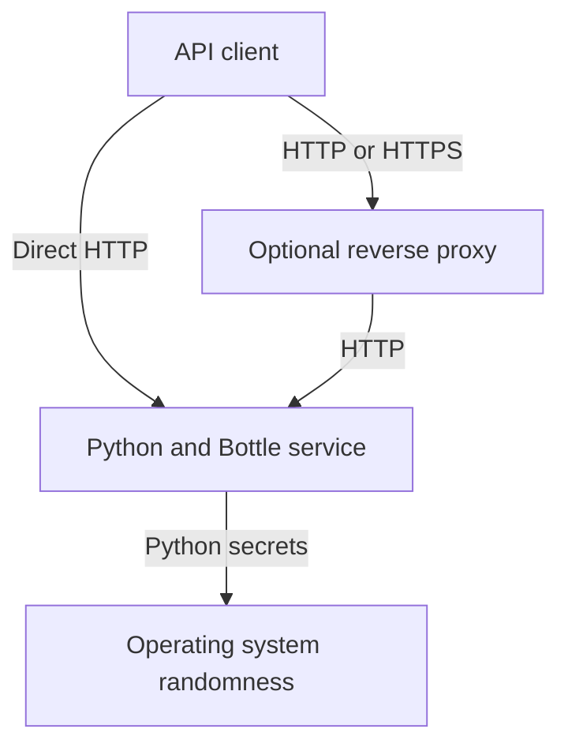
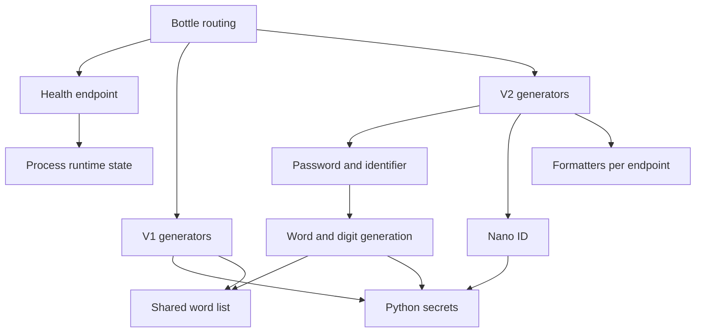
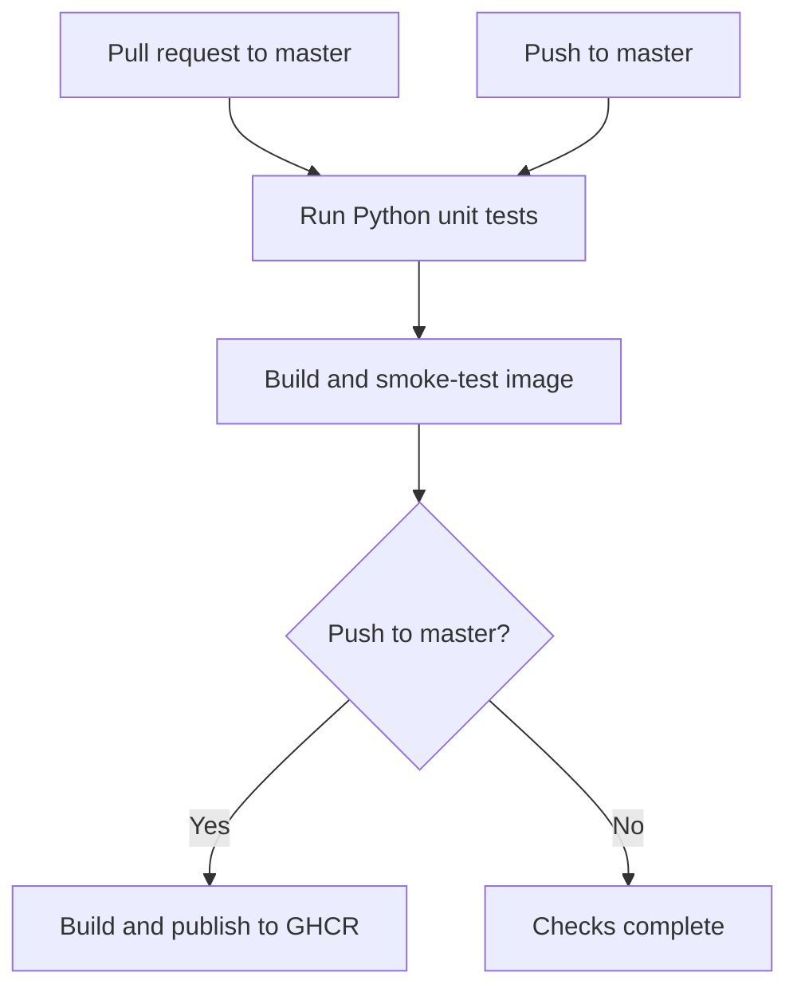

# Architecture overview

This document describes the current implementation of the service and its supporting repository configuration. Update it when those change.

## 1. Purpose and system context

The service provides HTTP endpoints that generate identifiers, tokens, and word-based passwords or passphrases. It is intended primarily for the maintainer's own use. See the [project scope](scope.md) for its purpose and boundaries.

Clients can include a browser, script, or another application. A reverse proxy can be used by a deployment, for example to terminate HTTPS or apply access controls; it is external to this repository. Direct HTTP access to the Bottle service is also possible, depending on the deployment.

## 2. Runtime structure

The application is implemented in a single Python source file, `app/simple-servicetag-generator.py`. Bottle supplies the HTTP routing and request/response objects. The diagram groups functions by responsibility; the boxes are not separate deployed services or Python modules.

- **Routing and validation:** Bottle selects a registered route. Each handler reads and validates its own parameters; validation behaviour is currently not identical across all V2 handlers.
- **Generation:** V1 routes generate service tags, word-based passwords, or short tokens. V2 password and identifier generation share the helper that selects words and digits. Nano ID has its own alphabet and character-generation helpers. Random selection uses Python's `secrets` module and the operating system's randomness source.
- **Formatting:** V1 handlers return simple text values. Each V2 generator has its own response-formatting function supporting some of text, JSON, XML, CSV, and HTML. These are separate implementations, not one common formatting module, and supported formats differ by endpoint.
- **HTML:** HTML responses are generated by the API handlers. They are supporting presentations of API results, not a separately deployed frontend application.
- **Health:** `/health` returns JSON containing a health status, timestamp, uptime, and a request count.

## 3. API groups and request handling

| Route group | Responsibility |
|---|---|
| `/health` | Health information and process-local counters. |
| `/v1/...` | Existing service tag, word-based password, and short-token generators, including existing aliases. |
| `/v2/password` and `/api/v2/password` | Configurable word-based password generation. |
| `/v2/identifier` and `/api/v2/identifier` | Long and short identifier forms derived from the same random parts. |
| `/api/v2/nanoid` | Configurable Nano ID generation. |

A typical generator request is routed to a handler, which reads its parameters, generates the requested value or values, and formats an HTTP response. The precise validation, output fields, suffix handling, and error behaviour depend on the handler.

## 4. State and storage

The application currently has **no implemented database, persistent result store, or registry of generated IDs**. It does not save generated values for later requests. This statement concerns the application code; browser caches, deployment logs, reverse proxies, and downstream systems may have their own storage behaviour.

There is nevertheless temporary in-memory state:

- `start_time` and `request_count` are held in process memory and used by `/health`; a Bottle `after_request` hook increments the request counter.
- The V2 Identifier and Nano ID use request-local sets to detect duplicates when producing multiple results in one response.

These values are not shared across separate processes or installations and do not survive a process restart. The request-local duplicate checks do not provide global uniqueness across requests.

## 5. Configuration and deployment

| Variable | Value passed when unset | Purpose |
|---|---|---|
| `APP_IP` | `0.0.0.0` | Bind address passed to Bottle. |
| `APP_PORT` | `3000` | Port passed to Bottle. |
| `APP_DEBUG` | `false` as a string | Passed directly as a string to Bottle's debug argument; it is not parsed as a boolean by the application. |

With the regular application start, the default string `false` is non-empty and therefore enables Bottle's debug mode. Setting `APP_DEBUG=false` has the same effect. Debug error responses can expose traceback details; the value shown in the table does not mean debug mode is disabled.

The checked-in Dockerfile uses `python:3.14-slim`, copies the application and `app/requirements.txt` into `/code`, installs the Bottle dependency (`bottle<=0.13`), and runs the Python application. It declares no application data volume. Actual port publishing, reverse proxies, TLS, and any access restrictions are deployment decisions outside the Dockerfile.

The repository also contains a vendored `app/bottle.py` development snapshot. It is not copied into the container image. Local execution can resolve this file differently from the container, and the tests use it as a fallback when no installed Bottle package is found.

## 6. Security and operational context

The application code does not implement its own authentication, authorization, or rate limiting. A deployment may provide additional protections externally; the repository alone does not establish whether they are present. The standalone Bottle server serves HTTP, while TLS can be supplied by an external component.

Generator randomness, entropy, collision limits, and suitable-use considerations are described in [Cryptographic foundations and limitations](cryptography.md).

## 7. Tests, build, and publication

GitHub Actions runs the workflow for pull requests targeting `master` and pushes to `master`. The test job installs the runtime dependency and runs the existing Python unit tests under Python 3.14. A following job builds a local image and smoke-tests `/health` and the V2 Identifier endpoint. Only a successful push to `master` proceeds to the separate build-and-publish job for GitHub Container Registry.

The publish job performs its own image build after the smoke-test job. The existing unit tests focus on the V2 Identifier and password regressions; the smoke test covers health and identifier access.

## 8. Related documents

- [Project scope](scope.md)
- [Cryptographic foundations and limitations](cryptography.md)
- [Decision workflow](workflows.md)
- [README](../README.md)

